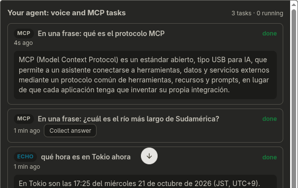

# Alexa Agent Voice Bridge

**Your own agent, any surface: answers that wait for you.**

One personal agent ([Hermes Agent](https://github.com/NousResearch/hermes-agent) or any OpenAI-compatible `/v1/chat/completions` endpoint) and one durable task store, shared by two surfaces:

1. **Voice:** an Amazon Echo, through a private Alexa custom skill.
2. **MCP:** any MCP client acting as an Alexa+-style assistant (there is no way yet to connect a self-hosted MCP server to Alexa+ on an Echo; see [Known limitations](#known-limitations)). The server is self-hosted, runs over Streamable HTTP, and speaks protocol **2026-07-28** and **2025-11-25** on the same endpoint. It also ships the **Agent Skill** that teaches a voice assistant how to use it, through the official MCP Skills extension.

Alexa cuts a voice turn at about 8 seconds, but an agent with tools takes from 5 seconds to several minutes. Here, a slow question asked by voice keeps running. Its answer is saved, and you can hear it on the Echo later or collect it from an MCP client, and the other way around. Tasks survive closed sessions, other surfaces, and server restarts.

> Spanish documentation, including the original voice-only guide: [docs/es/README.md](docs/es/README.md).

## Try it in one command (no Echo needed)

```bash
npm ci && npm run demo
```

In about 20 seconds this starts the real `src/server.js` with a **simulated agent** (no LLM; it is labeled as such and answers after 4 s, longer than the voice turn). It then drives it with synthetic Alexa requests (the same JSON the Alexa cloud sends) and the official MCP client:
1. A slow question asked by voice is collected over MCP.
2. A question asked over MCP survives a server restart.
3. The next time you open the skill ("Alexa, mango"), the Echo plays a chime and reads that answer first.

`npm run demo -- --real-agent` does the same against the agent configured in `.env`.

| Judging criterion | Where to look |
|---|---|
| Technical implementation | One task store, two surfaces ([`src/agent.js`](src/agent.js)). The MCP server serves 2026-07-28 and 2025-11-25 on one endpoint, plus the Skills extension and an MCP App ([`src/mcp.js`](src/mcp.js), [`src/skills.js`](src/skills.js)). `npm test` runs the real server in both protocol eras. |
| Design | "Answers that wait for you": the Echo says what it understood, keeps working, and later plays a chime and reminds you what you asked (and from which device). Owner-only voice (Alexa Voice ID, verified on a real Echo) ignores the TV. |
| Potential impact | Your *own* agent, by voice, in Spanish, hands-free, with your data on your machine. Useful for people who can't or don't want to type, such as older adults and busy hands. |
| Quality of the idea | Built on the open standards the Alexa+ track names: any MCP host can act as an Alexa+-style assistant today, and the server ships the Agent Skill that teaches it how to behave. When Alexa+ accepts self-hosted MCP servers, the same server plugs in. |

```text
 "Alexa, mango"                                     any MCP client (Alexa+-style agent,
  Echo → Alexa cloud → custom skill                  Claude Code, MCP Inspector, …)
        │ HTTPS 443 (Tailscale Funnel, /alexa only)        │ Streamable HTTP, Bearer token
        ▼                                                  ▼
 ┌──────────────────────── src/server.js (one Node process) ────────────────────────┐
 │  /alexa  ask-sdk handlers (signature verified)      /mcp  src/mcp.js + skills.js │
 │  Voice ID filter (src/voice-id.js)              tools · skill:// · ui:// MCP App │
 │                         └──────────┬──────────────┘                               │
 │                     src/agent.js: callAgent + task store (data/tasks.json)       │
 └────────────────────────────────────┼──────────────────────────────────────────────┘
                                      ▼
                     your agent: POST /v1/chat/completions
```

## What's in the repo

| Path | What it does |
|---|---|
| [`src/agent.js`](src/agent.js) | `callAgent()`, plus the task store shared by both surfaces. The store persists to `data/tasks.json` with atomic writes (tmp + rename), keeps tasks for `TASK_TTL_MS` (24 h by default), and marks tasks left pending by a crash as `failed`. |
| [`src/server.js`](src/server.js) | Express app: the Alexa skill on `/alexa`, MCP on `/mcp`, `/health`. Listens on `127.0.0.1` by default. |
| [`src/mcp.js`](src/mcp.js) | MCP server built on the official TypeScript SDK v2: `createMcpHandler` + `toNodeHandler`, stateless. Checks Origin (403) and Bearer token (401). |
| [`src/skills.js`](src/skills.js) | Serves `skills/` over MCP with the [Skills extension](https://modelcontextprotocol.io/extensions/skills/overview) (`io.modelcontextprotocol/skills`, SEP-2640): `skills/list`, `skills/get`, and `skill://` resources with SHA-256 manifests. |
| [`skills/voice-agent-bridge/SKILL.md`](skills/voice-agent-bridge/SKILL.md) | The Agent Skill ([agentskills.io](https://agentskills.io/specification) format). It covers spoken-length answers, the async pattern, answers requested earlier by voice, es-US pitfalls, and the close word. |
| [`src/ui/task-board.html`](src/ui/task-board.html) | MCP App (`io.modelcontextprotocol/ui`): an interactive board of the tasks from every surface, rendered by MCP Apps hosts next to `list_tasks`. |
| [`src/voice-id.js`](src/voice-id.js) | Owner-only mode: uses Alexa Voice ID so the TV or a bystander can't talk to your agent. |
| [`config/`](config) | Interaction model (es-US/es-MX/es-ES) and skill manifest. |
| [`scripts/`](scripts) | `npm run demo` (the one-command demo above), `npm run skill` (create, model, endpoint, simulate via SMAPI) and `npm run nlu` (intent resolution against the live model). |
| [`test/`](test) | `node:test` suites: task store, synthetic Alexa requests, MCP in both protocol eras, cross-surface flows, Voice ID, and the skill's frontmatter. |

## The MCP server

- **Endpoint:** `POST /mcp` (GET and DELETE answer `405`; the server is stateless).
- **Protocol:** 2026-07-28 with clients that negotiate it (`server/discover`), and 2025-11-25 or earlier with `initialize`, on the same URL. Built with `@modelcontextprotocol/server@2.3.1` and `@modelcontextprotocol/node@2.1.1`, pinned exactly in [`package.json`](package.json).
- **Auth:** `Authorization: Bearer $MCP_TOKEN`. Without it the server answers `401`; without `MCP_TOKEN` configured, `503`. A present `Origin` outside `MCP_ALLOWED_ORIGINS` gets `403`.

| Tool | Input | Output |
|---|---|---|
| `ask_agent` | `question`, `wait_seconds?` (default 5, max 20) | `{status: "done", task_id, answer}` or `{status: "pending", task_id}` (or `failed` with the reason) |
| `get_agent_result` | `task_id`, `wait_seconds?` (default 0, max 20) | `{status: "done" \| "pending" \| "failed" \| "expired", answer?}` |
| `list_tasks` | `include_delivered?` | `{tasks: [{task_id, question, status, origin: "voice" \| "mcp", created_at}]}` |

All tools return `structuredContent` (with an `outputSchema`) and the same JSON as text. Answers are plain text with Markdown stripped, ready to be spoken. A task counts as delivered once any surface hands its answer over, so the Echo never repeats an answer you already got over MCP.

The server also publishes `skill://voice-agent-bridge/SKILL.md` through the Skills extension, declared in both protocol eras. A host that supports the extension can discover and load the skill straight from the server it describes.

**MCP App: a screen for a speaker-only Echo.** `list_tasks` links a `ui://voice-agent-bridge/task-board.html` resource (`text/html;profile=mcp-app`). Hosts that support [MCP Apps](https://modelcontextprotocol.io/extensions/apps/overview) render an interactive board, and hosts without UI support ignore the link and use the JSON.
- The board shows every task with its origin (ECHO or MCP) and status, and refreshes itself while tasks are running.
- From the board you can collect an answer (`get_agent_result`) or ask a new question (`ask_agent`), through the host's tool-call bridge.
- It is plain HTML and JavaScript with no external resources, so it works under the default MCP Apps content security policy.
- Verified in [MCPJam Inspector](https://github.com/MCPJam/inspector) 3.16.0 against this server and a real agent. The "ECHO" task below was asked by voice:



**Connect a client:**

```bash
# Claude Code
claude mcp add --transport http voice-bridge http://127.0.0.1:3107/mcp --header "Authorization: Bearer $MCP_TOKEN"

# MCP Inspector (CLI mode)
npx -y @modelcontextprotocol/inspector@2.11.0 --cli http://127.0.0.1:3107/mcp --transport http \
  --header "Authorization: Bearer $MCP_TOKEN" --method tools/list
```

For a remote client, publish only `/mcp` on your HTTPS host (for example `tailscale funnel --bg --https=443 --set-path=/mcp http://127.0.0.1:3107/mcp`).

## The Agent Skill

[`skills/voice-agent-bridge/SKILL.md`](skills/voice-agent-bridge/SKILL.md) teaches a voice assistant to:
- answer in one or two sentences;
- ask with a short wait and, if the answer is `pending`, say so, keep talking, and collect it later;
- deliver at the start of a conversation the answers the user asked for earlier, including those asked by voice on the Echo;
- avoid es-US speech-recognition traps (never start with *dime*);
- close with the close word.

Load it from the folder (for example `.claude/skills/voice-agent-bridge/`) or over MCP.

## Voice (the Echo)

| You say | What happens |
|---|---|
| "Alexa, mango" | Opens the conversation. If an answer is waiting, a chime plays and it reads the answer first, recalling the question and, if it was asked from an MCP client, where it came from: "Tengo la respuesta a lo que me pediste desde otro dispositivo: …". |
| "qué hora es en Santiago", "busca…", "resume…", "pregúntale…" | Goes to your agent with the full sentence. |
| *(the agent takes more than 5 s)* | "Entendí: *<what it heard>*. Me va a tomar un momento. Di repite…": you hear what Alexa transcribed, and the task keeps running. |
| "repite" | Waits up to 5 s more and reads the answer. On the second miss it ends the session, and the answer stays saved. |
| "maracuyá" | Closes. Anything in progress is saved. |
| *(every answer)* | Spoken without Markdown, and a bare link is spoken as just the site ("meteochile.gob.cl"), or skipped if the answer already names it. The full answer, links included, also appears as a card in the Alexa app (and on an Echo Show screen). |

Why it is built this way (lessons from a real Echo in es-US, detailed in [docs/es/README.md](docs/es/README.md#por-qué-está-hecho-así)):
- **Invocation name.** It must be a word the speech recognizer transcribes exactly. "davi" came out as "david", so the invocation is "mango".
- **Free speech.** `AMAZON.SearchQuery` can't be a bare `{query}`, so there is one intent per leading word (`Free<Word>Intent`), and the backend puts the word back.
- **es-US quirks.** *Dime* is heard as the US coin, and "un"/"una" become "1". The backend reverts the latter.
- **The ~8 s limit.** It applies regardless of progressive responses, hence the background tasks.

### Owner-only mode (Voice ID)

> **Verified on a real es-US Echo** with the skill in development stage (2026-10-21; redacted log in [`docs/evidence/voice-id-real-echo.jsonl`](docs/evidence/voice-id-real-echo.jsonl)). Every request from the enrolled owner carried `context.System.person`: launch, free speech and `repite`. A TV talking during an open session arrived without it, was ignored, and the session closed after its third phrase. The same cases are covered by synthetic tests ([`test/voice-id.test.js`](test/voice-id.test.js)).

With `VOICE_ID_MODE=enforce`, only a speaker that Alexa recognizes by voice reaches the agent, `repite`, or the announcement of saved answers. After `VOICE_ID_MODE=enroll`, that speaker must be the enrolled owner. Recognition comes from `context.System.person.personId`, which requires the skill permission `alexa::person_id:read` and "Personalize skills" on your Voice ID.

So, while the session's microphone is open, a TV or someone talking to you doesn't become a message for your agent. The filter covers every handler, including `AMAZON.FallbackIntent`, where most TV speech lands. An ignored phrase gets "No reconocí tu voz. Si me hablabas a mí, repítelo." The close word is accepted from anyone. After `VOICE_ID_MAX_IGNORED` (default 3) unrecognized phrases in a row, the session closes, so a TV can't keep it open.

Limits:
- Voice ID classifies each request as a whole. It does not separate overlapping voices, so if the TV talks *while* you talk, the request may not be recognized as yours and you repeat it. On the real Echo, one of two owner phrases spoken over the TV was not recognized; repeating it more clearly worked.
- It is only as good as Alexa's recognition in your locale.

## Built during the submission window

The voice bridge began as a private prototype in May–June 2026 (Echo → skill → backend → agent, end to end). Work done during the submission window (from 2026-08-31):

- **2026-10-21, voice rework**, imported in the first commit of this repo ([`d7d8393`](../../commit/d7d8393)): free-speech intents, thinking mode with `repite`, the close word, ASK CLI scripts (`npm run skill`), and `npm run nlu`.
- **This repository's history** (`git log`):
  - persistent shared task store (F1);
  - MCP server on SDK v2 in both protocol eras (F2);
  - voice ↔ MCP flows (F3);
  - the Agent Skill, served over MCP (F4);
  - Voice ID owner-only mode (F4b), verified on a real Echo;
  - all the tests in `test/` except `nlu-cases.json`.
- **Open source contribution:** [alexa/ask-cli#513](https://github.com/alexa/ask-cli/pull/513) makes `ask util generate-lwa-tokens` work without `~/.ask/cli_config`, which blocked setting up the skill from an AI coding agent (unit suite 1639 → 1640 passing).
- **The phase-by-phase work log** (in Spanish), with the verification required for each phase: [`docs/hackathon-log.md`](docs/hackathon-log.md).

## Setup

About 20 minutes; see **[docs/SETUP.md](docs/SETUP.md)**. In short:

```bash
npm ci && cp .env.example .env               # agent URL/token, ALEXA_ENDPOINT, MCP_TOKEN
npm i -g ask-cli && ask configure            # Amazon login (the same account as your Echo)
tailscale funnel --bg --https=443 --set-path=/alexa http://127.0.0.1:3107/alexa
npm start
npm run skill -- create                      # creates the skill, uploads the model, enables it
npm run skill -- simulate "abre mango" --new
```

## Verify

| Claim | Command or file |
|---|---|
| Unit and integration tests (store, voice, MCP in both eras, cross-surface, Voice ID, skill) | `npm test` |
| Syntax of every entry point | `npm run check` |
| Every test phrase reaches the expected intent on the live model | `npm run nlu` |
| The whole voice chain through the Alexa cloud | `npm run skill -- simulate "abre mango" --new` |
| Tool schemas are portable | `npx -y @modelcontextprotocol/inspector@2.11.0 --cli <url>/mcp --transport http --header "Authorization: Bearer $MCP_TOKEN" --method tools/list --strict` |
| The skill served over MCP passes Skills-extension conformance and digest checks | same Inspector command with `--method skills/list --verify` |
| The skill is valid Agent Skills | `uvx --from 'git+https://github.com/agentskills/agentskills#subdirectory=skills-ref' skills-ref validate skills/voice-agent-bridge` |
| Which protocol version each client negotiated | `grep '"path":"/mcp"' data/alexa-debug.log` (field `mcpProtocol`) |
| Voice ↔ MCP handoff and persistence across a restart, without an Echo | `npm run demo` |
| The MCP App renders and calls tools | `npx -y @mcpjam/inspector@3.16.0`, add the server with a bearer token, run `list_tasks` in the Playground |

## Configuration

Everything lives in `.env` (see [`.env.example`](.env.example)):

| Variable | Purpose |
|---|---|
| `HERMES_GATEWAY_URL`, `HERMES_GATEWAY_TOKEN`, `HERMES_API_MODEL` | Your agent's OpenAI-compatible endpoint. |
| `MCP_TOKEN`, `MCP_ALLOWED_ORIGINS` | MCP bearer token (empty = MCP off) and allowed Origin hostnames. |
| `TASKS_FILE`, `TASK_TTL_MS` | Where tasks persist and how long they live. |
| `VOICE_GATEWAY_TIMEOUT_MS`, `HERMES_MAX_WAIT_MS` | Wait inside a voice turn (5 s) and maximum wait for the agent (10 min). |
| `VOICE_ID_MODE`, `VOICE_OWNER_PERSON_ID`, `VOICE_ID_MAX_IGNORED`, `VOICE_ID_SILENT` | Owner-only voice mode. |
| `ASSISTANT_NAME`, `ALEXA_RETURN_PHRASE`, `ALEXA_ENDPOINT`, `ALLOW_USER_IDS` | Spoken name, reopen phrase, public skill URL, allowed Alexa users. |
| `READY_SOUND` | Alexa sound-library chime played before an answer that waited (empty = none). |
| `PORT`, `HOST` | Where the backend listens (`127.0.0.1:3107` by default). |

## Known limitations

- **One owner per deployment.** It is a personal agent: every task belongs to the same person, and there are no per-user stores.
- **No Alexa+ connection.** There is no documented way to connect a self-hosted MCP server to Alexa+ on an Echo, so the Echo enters through the classic custom skill and MCP clients stand in for Alexa+.
- **Static bearer token** instead of OAuth. Clients that only support OAuth connectors can't use it.
- **Restarts.** A task running when the server restarts ends as `failed` ("Tarea interrumpida por reinicio.").
- **Not publishable as is.** The skill would need a privacy policy, account linking for multiple users, and hosting that doesn't depend on a PC.

## License

[MIT](LICENSE)
